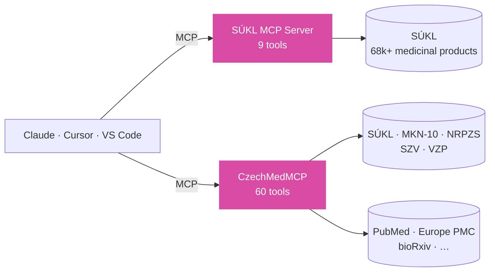

<div align="center">


[](https://git.io/typing-svg)

[](https://linkedin.com/in/petrsovadina)
[](https://portfolio-sovadina.vercel.app)
[](mailto:petr.sovadina9@gmail.com)

</div>

```ts
// $ whoami
const petr = {
  role: "AI Engineer",
  location: "Brno, CZ",
  building: {
    "Doktůrek.ai": "AI for Czech general practitioners (co-founder)",
    "ABUGO Group": "Claude, MCP & agent workflows for SaaS teams",
    openSource: "MCP servers that plug AI into Czech health data",
  },
  stack: {
    ai: ["Claude", "MCP", "LangGraph", "RAG"],
    code: ["TypeScript", "Python", "Next.js", "Nuxt", "FastAPI"],
    health: ["HL7 FHIR", "Medplum", "SÚKL", "MKN-10/11"],
  },
  workflow: ["spec-first (GitHub Spec Kit)", "Claude Code", "security review before any install"],
  background: "family of doctors — healthcare is home",
  openTo: ["freelance", "consulting"],
} as const;
```

## ⚡ Try it

Czech drug database inside your AI assistant. No install — add the remote MCP server to your client config:

```json
{
  "mcpServers": {
    "sukl": {
      "type": "url",
      "url": "https://sukl-mcp.vercel.app/mcp"
    }
  }
}
```

Need MKN-10, healthcare providers, reimbursements or PubMed too? CzechMedMCP has 60 tools:

```bash
uv tool install git+https://github.com/petrsovadina/CzechMedMCP.git
npx @modelcontextprotocol/inspector czechmedmcp run   # browse all 60 tools
```

## 🔌 How it fits together



## ✨ Featured Projects

<table>
<tr>
<td width="50%" valign="top">

### 💊 [SÚKL MCP Server](https://github.com/petrsovadina/SUKL-mcp)
`🟢 live` `9 tools` `68k+ products`

MCP server for the Czech medicinal products database. Typo-tolerant search, ATC lookups, monthly data refresh via CI. Landing page, MCP endpoint and demo chat on a single URL.

`TypeScript` `Next.js 16` `MCP` `Vercel` · [Live demo →](https://sukl-mcp.vercel.app)

</td>
<td width="50%" valign="top">

### 🧰 [CzechMedMCP](https://github.com/petrsovadina/CzechMedMCP)
`🟢 production` `60 tools` `open source`

23 Czech tools (SÚKL, MKN-10, NRPZS, SZV, VZP) and 37 global biomedical ones (PubMed, Europe PMC, bioRxiv). Works with Claude Desktop, Cursor and VS Code.

`Python` `MCP` `uv` `Railway` · [Docs →](https://czech-med-mcp-docs.vercel.app)

</td>
</tr>
<tr>
<td width="50%" valign="top">

### 📚 [OpenClinical Knowledge Base CZ](https://github.com/petrsovadina/OpenClinical-Knowledge-Base-CZ)
`🧪 research` `open data`

Turns unstructured Czech guidelines, SPCs and regulatory bulletins into structured JSON for RAG and decision support. For research and education — not a medical device under MDR.

`TypeScript` `JSON` `RAG`

</td>
<td width="50%" valign="top">

### 🏷️ [MKN11-coder](https://github.com/DigiMedic/MKN11-coder)
`🧪 prototype`

Assisted ICD-11 (MKN-11) coding: GPT-4 extracts diagnoses from unstructured text, suggests codes and scores each suggestion's confidence.

`TypeScript` `Next.js` `OpenAI`

</td>
</tr>
</table>

<sub>Earlier work under <a href="https://github.com/DigiMedic">DigiMedic</a>: <a href="https://github.com/DigiMedic/Ask-EHDS">Ask-EHDS</a> (EHDS docs for the Czech context) · <a href="https://github.com/DigiMedic/PillSee">PillSee</a> (medication chat, architecture stage) · <a href="https://github.com/DigiMedic/DigiMedic-FHIR-Backend">FHIR backend</a></sub>

## 🛠️ Stack

<div align="center">

[](https://skillicons.dev)


</div>

<div align="center">

<picture>
  <source media="(prefers-color-scheme: dark)" srcset="https://raw.githubusercontent.com/petrsovadina/petrsovadina/output/github-snake-dark.svg">
  <source media="(prefers-color-scheme: light)" srcset="https://raw.githubusercontent.com/petrsovadina/petrsovadina/output/github-snake.svg">
  
</picture>

*Open to freelance projects and consulting — especially where AI meets real healthcare data.*

[](https://linkedin.com/in/petrsovadina)


</div>
